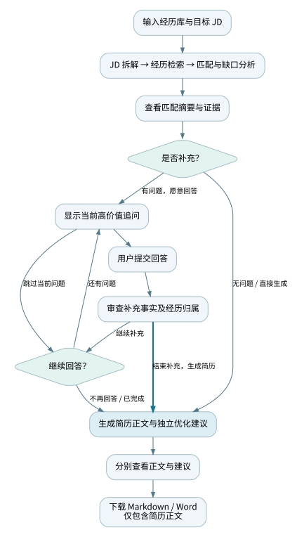
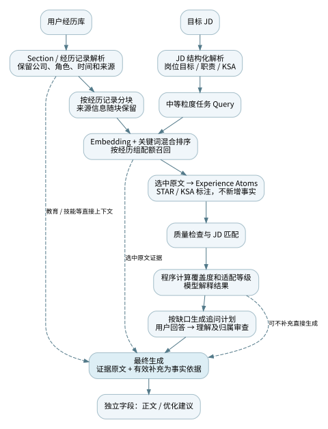

# 1. 文档概览

| 项目 | 内容 |
|---|---|
| 产品 | CariAgent：基于真实经历与目标 JD 的 AI 简历定制助手 |
| 文档版本 | v0.4；这是文档版本，不代表应用另行发布了 v0.4 |
| 更新日期 | 2026 年 10 月 17 日 |
| 编写方式 | 根据历史 PRD、研发日志、设计说明、当前代码及测试记录回溯整理 |
| 当前形态 | Streamlit 网页 MVP，保留 CLI；中英文独立启动入口，共享核心流程 |
| 状态依据 | 已实现内容以当前仓库为准；历史决定保留其阶段背景；未验证收益不记为实测成果 |

本文件用于明确产品目标、交互与业务规则、验收条件，并集中记录关键研发取舍。当前代码核对基于 `english-app` 分支提交 `138ed53`。用户已反馈创建英文线上应用，但未提供可复核网址，线上验收不在本文件中标记为通过。

# 2. 背景、用户与产品目标

## 2.1 问题定义

求职者通常需要针对不同岗位反复挑选和改写经历，而一份现有简历并不等于其完整经历。原始材料又常有口语化、重复、细节遗漏等问题。直接让大模型生成简历，可能遗漏相关证据、夸大结果，或把不同经历的事实混用。

CariAgent 将简历定制拆成一条可检查的证据链：

**理解岗位 → 找到证据 → 判断覆盖与缺口 → 用户补充 → 组织简历。**

## 2.2 目标用户与核心场景

当前优先面向需要针对具体 JD 定制简历的学生与早期职业求职者。跨方向求职者也是潜在用户，但资深复合型人才的专门适配尚未验证。

典型场景：用户持有多段实习、项目和校园经历，为某个目标岗位筛选最相关事实；系统识别可补充的信息，用户选择回答或跳过，最终得到可继续编辑的简历草稿。

用户及问题依据主要来自作者真实求职流程、自测和少量试用反馈，不等同于完成了规模化用户研究。

## 2.3 目标与边界

| 目标 | 产品要求 |
|---|---|
| 针对岗位选择经历 | 检索依据来自目标 JD，避免只做通用润色 |
| 保持事实准确 | 事实可归属到原始经历或用户补充，不编造结果、不跨经历借证据 |
| 支持用户参与 | 用户可理解缺口、回答或跳过，并自主结束补充 |
| 交付可使用草稿 | 简历正文与优化建议独立展示，下载仅含正文 |
| 提供英文使用路径 | 英文界面、提示词、追问、生成与导出使用一致语言 |

当前不包含：自动搜索并投递岗位、账号与支付系统、跨会话长期事实库、生产级多租户隔离、OCR/视觉解析、PDF 精排版、岗位录用预测，以及已经完成的 LangGraph 多 Agent 架构。

# 3. 当前能力与版本范围

| 模块 | 当前交付 |
|---|---|
| 输入 | 文本编辑；TXT、Markdown、DOCX、文本型 PDF 内容提取；内置虚拟示例 |
| JD 理解 | 岗位目标、职责、KSA、基础条件与关键词结构化 |
| 证据处理 | Section 与单段经历解析、混合检索、来源信息、Experience Atoms |
| 匹配 | 材料质量检查、要求覆盖判断、程序评分、适配解释 |
| 用户补充 | 网页逐题回答、跳过、查看提问原因、直接生成 |
| 输出 | Markdown 简历正文、独立优化建议、Markdown / DOCX 下载 |
| 语言 | 中文 `ui/app.py`；英文 `ui/app_en.py`，分别运行或部署 |
| 研发诊断 | API 调用元数据、工作流 trace、可选中间 JSON / Markdown 文件 |

图片扩展名虽出现在上传控件中，当前代码会提示改为粘贴文字，不能据此宣称支持图片理解。网页默认不把生成结果写入 outputs；会话缓存也不等于长期保存资料。

# 4. 产品流程与交互

## 4.1 用户主流程

图中“审查补充事实及经历归属”可以直接进入“生成简历”，也可以继续处理下一题；不要求返回匹配摘要，不强制回答全部问题。

**操作边界：**用户应先提交当前回答，再点击生成。当前生成按钮不会代为提交尚未提交的文本框内容。

## 4.2 系统处理流程

| 阶段 | 输入 → 输出 | 职责边界 |
|---|---|---|
| JD 解析 | JD → 结构化岗位要求 | 不把 JD 未写出的细分能力任意扩展为独立要求 |
| 经历解析 | 经历库 → sections / experience records | 分类并保留事实；同公司同角色同时间的任务不拆成多份经历 |
| 证据检索 | 经历块＋JD task units → selected chunks | 检索原文，保留来源；不直接生成简历 |
| 结构化与检查 | 选中证据 → atoms、材料质量检查 | 标注 STAR / KSA；不重新读取完整经历库绕过检索 |
| 匹配与评分 | JD＋atoms → 覆盖、缺口、分数与解释 | 模型分类，程序计算分数；解释不能扩大结论 |
| 追问与理解 | 缺口＋回答 → 审查后的补充 | 不替用户补事实，不自动写回原经历库 |
| 最终生成 | 原文证据＋有效补充＋必要标注 → 两类输出 | 正文和建议分离，不暴露内部字段 |

## 4.3 网页页面与关键动作

| 页面 | 用户操作 | 结果 |
|---|---|---|
| 经历库 | 编辑、导入、继续 | 将经历作为当前流程输入；可查看解析后的经历分类 |
| 目标 JD | 编辑、导入、分析 | 展示岗位要求与关键词，再进入匹配 |
| 匹配摘要 | 查看适配解释、强项、缺口和证据 | 用户决定是否继续补充；低分是建议，不替用户决定停止 |
| AI 追问 | 查看原因、提交、跳过、返回、直接生成 | 已提交补充用于本轮；可不回答所有问题 |
| 简历草稿 | 查看正文及独立建议、下载 | Markdown 与 Word 文件只包含正文 |

## 4.4 关键异常处理

| 情况 | 预期行为及当前限制 |
|---|---|
| 输入为空 | 在发起有效分析前提示补充输入 |
| 文件不支持或解析失败 | 显示原因，允许改用纯文本；不伪装成读取成功 |
| 缺少 Key、API 调用失败 | 显示错误，保留页面可用性；当前不承诺任意节点自动恢复 |
| 无候选追问 | 允许直接生成 |
| 不知道、没有或跳过 | 接受信息边界，不推断不存在的结果 |
| 材料更新 | 不应把旧输入的分析当作新结果；现有缓存键包含输入与语言，但编辑同步和旧状态清理仍需专项验收 |
| 刷新、离开或服务重启 | 不承诺跨会话恢复；页面内切换与长期保存不是同一能力 |

# 5. 详细功能需求

P0 表示核心路径必需，P1 表示辅助理解或研发效率。验收条件描述应有行为；是否已通过见第 9 章。

| 编号 | 优先级 | 需求与关键规则 | 验收条件 |
|---|---|---|---|
| IN-01 | P0 | 输入完整经历库与一个目标 JD，支持声明的文本文件格式 | 两项输入可进入分析；空输入和不支持类型有明确反馈 |
| JD-01 | P0 | 用 KSA 理解岗位，基础学历、年限等独立保留 | 结构化结果反映原 JD；不任意增加细碎要求 |
| EV-01 | P0 | 先解析 section 和单段经历，再在经历组内检索 | 工作/实习与项目独立召回；每块有可识别来源 |
| EV-02 | P0 | 仅对选中证据结构化，事实与标注分离 | atom 关联正确经历；冲突时以原文与用户回答为准 |
| MT-01 | P0 | 给出覆盖判断、缺口及程序计算的适配等级 | 确定的匹配标签产生确定分数；文字解释不重新定分 |
| HU-01 | P0 | 基于高价值缺口排序追问，解释提问目的 | 用户能看到当前问题及相关要求 / 经历，并可跳过 |
| HU-02 | P0 | 审查已提交回答，保留事实归属，仅用于本轮 | 回答与问题关联；不混入另一段经历，不自动更新底层事实库 |
| HU-03 | P0 | 用户可以结束补充并生成简历 | 审查后有直接生成路径；无需回到匹配摘要或答完所有题 |
| RES-01 | P0 | 输出简历正文与优化建议两个独立字段 | 页面分区展示；Markdown、DOCX 均只导出正文 |
| RES-02 | P0 | 保留真实公司、角色及已知时间；不编造量化成果 | 输出能回溯证据；缺失内容用稳健表达，不填假数字 |
| EN-01 | P0 | 英文入口覆盖界面、提示词、本地追问、错误回退和输出 | 英文示例链路无中文残留；不改 schema 键、枚举及事实关联 |
| OBS-01 | P1 | 保留可调试状态和调用元数据 | 可定位阶段、输入输出及调用量；日志不记录密钥 |

**状态一致性补充：**v0.3 记录过编辑草稿与业务输入分离的修复，但当前代码未见同名实现。该问题保留为待核实项，不能仅依据旧文档标记解决。

# 6. AI 行为、评分与追问规则

## 6.1 事实与证据归属

事实来源仅包括原始经历、检索原文及用户补充。JD 分析、atoms、匹配标签、分数和摘要是辅助标注，不是新增事实。

- 每条证据随流程保留 section、公司/项目、具体经历及相关问题的关联。
- 同一经历内任务可合并表达，不得把不同经历的行动或成果拼到一起。
- 用户否认或无法确认的信息不写成事实；缺少 Result 不补造结果。
- 正文不出现 chunk ID、内部 score、检索元数据或调试分析。
- 模型输出使用 schema 约束结构；结构正确仍需核对事实和归属。

## 6.2 检索规则与实现边界

| 项目 | 当前方案 |
|---|---|
| Query | 岗位目标、主要职责形成中等粒度 task units，关键词 / KSA 辅助 |
| 文档粒度 | 经历原文 chunk；默认长度 620 字符、重叠 100 字符 |
| 排序 | 语义相似度与关键词重合混合；默认权重 0.72 / 0.28 |
| 召回组配额 | 工作/实习 12、项目 6、校园/其他 3；是 chunk 配额，不是简历 bullet 数 |
| 直接上下文 | 教育、技能、证书等不参与同一竞争式召回，保留为背景 |
| Embedding | `text-embedding-3-small` |
| 持久化 | 运行时 embedding 与内存相似度计算；未部署持久化向量库 |

上述参数是当前实现基线，不是所有人群通用的最优值。最终生成保留选中原文，默认不截断；优先减少重复中间上下文，再考虑损失原始证据的节省方式。

## 6.3 证据覆盖度分数

Readiness score 衡量当前材料对 JD 的证据覆盖，不是录用概率或候选人整体能力分。

`内部得分 = Σ(要求权重 × 覆盖分) / Σ要求权重`；内部范围 0–1，界面可转换为百分制。

| 覆盖等级 | strong | medium | weak | none |
|---|---|---|---|---|
| 覆盖分 | 1.00 | 0.65 | 0.35 | 0.00 |

当前重要性映射：high → 1.5；medium → 1.0，若为 ability 则为 0.8；low → 0.6。覆盖等级由模型的 match level 与 evidence quality 保守映射后计算。

| 百分制区间 | 适配等级 | 展示含义 |
|---|---|---|
| ≥85 | high_fit | 高覆盖，可继续组织简历 |
| ≥70 且 <85 | good_fit | 良好覆盖 |
| ≥55 且 <70 | partial_fit | 部分覆盖，谨慎补充 |
| ≥40 且 <55 | weak_fit | 有限覆盖 |
| <40 | low_fit | 核心要求支撑不足，建议重新考虑 |

程序计算减少了算分漂移，但模型仍参与前置分类，因此重复运行不保证完全同分。早期日志的多因子乘法、STAR 完整度等属于探索记录，不是当前总分公式。

## 6.4 Human-in-the-loop

网页当前根据匹配缺口生成候选问题，按优先级逐题展示；用户可提交、跳过或随时生成。回答理解结果保留可用事实与经历关联；页面中的补充后估计分不能当作重新执行完整匹配后的实测提升。

必须区分历史机制与当前入口：

| 项目 | 网页当前行为 | CLI / 历史机制 |
|---|---|---|
| 初始问题 | 按缺口生成并排序展示 | 另有话题池与交互控制 |
| 高分停止 | 页面不按 0.8 阈值强制跳过所有追问 | CLI 存在 readiness 阈值判断 |
| 同话题深挖 | 当前网页主要处理既有候选题 | CLI 有动态同话题追问、澄清及预算控制（当前常量：总问题上限 10、每话题追加上限 2、澄清预算 1） |
| 用户结束 | 可直接点击生成 | 可使用控制词结束 |

“顺着回答深入追问”是研发中的重要探索，不能据此宣称当前网页已完整采用 CLI 的动态追问机制。

# 7. 架构、状态与非功能要求

## 7.1 状态与模块

当前为共享工作流函数与统一状态驱动的多步骤 AI 应用，尚未迁移为 LangGraph 多 Agent 系统。用户体验保持同一助手连续理解，但各模型调用不必继承完整对话。

| 状态层 | 保存内容 |
|---|---|
| 原始事实 | 经历库、JD、补充回答 |
| 检索证据 | sections、选中 chunks、provenance |
| 结构化标注 | atoms、质量检查、匹配与缺口 |
| 决策与交互 | 分数、适配结论、问题、审查结果、分支记录 |
| 展示与诊断 | 正文、建议、trace、API payload 元数据 |

关键模块：`core/simple_mvp.py` 管理步骤与状态；`core/retrieval.py` 负责检索；`prompts/` 与 `prompts/en/` 管理提示词；`ui/app.py` 提供共享页面，`ui/app_en.py` 启动英文模式。

## 7.2 质量与运行要求

| 维度 | 要求与当前边界 |
|---|---|
| 正确性 | 不制造事实、不串经历；依赖样例和人工核查，尚无大规模事实准确率数据 |
| 等待体验 | 展示阶段进度与错误；日志曾记录约 3 分 20 秒的单次等待，不作为稳定性能基线 |
| 稳定性 | 支持调用重试及页面报错；尚无跨重启 checkpoint、完整后台任务恢复或稳定 SLA |
| 隐私 | Key 通过运行环境或 Streamlit Secrets 注入；资料与密钥不提交 GitHub；原文会发送至模型 / embedding 服务，隐私告知仍需完善 |
| 存储 | 网页默认 `CARIAGENT_SAVE_OUTPUTS=0`；会话与缓存可能留有运行数据，不承诺跨会话保存，也不等于零留存 |
| 成本 | 记录调用元数据与 usage，按步骤传递必要上下文；没有经控制实验验证的节省比例 |
| 语言 | 中英文分别部署，核心逻辑复用；不通过修改来源归属或虚构名称实现翻译 |

# 8. 产品演进与关键技术决策

以下按材料可确认的阶段编排；无明确日期的阶段不补造日期或发布版本号。历史中的“已解决”反映当时结论，不替代当前代码及测试核对。

| 阶段 | 问题 / 观察 | 关键决策及取舍 | 证据与结果 |
|---|---|---|---|
| 2026-05-08：场景形成 | 作者投递时反复评估岗位、筛选所有经历、定制简历 | 从完整自动求职设想中收束为经历库＋JD 的证据匹配与生成；保留用户判断 | 研发日志记录原始求职路径及范围考虑；未实现自动投递 |
| 早期：追问与可解释评分 | 全量生成难发现遗漏，单凭“AI 觉得足够”无法解释何时停止 | 引入 STAR/KSA、显式匹配、重要性权重、缺口与停止条件 | 日志截图保留多种评分与追问方案；部分公式后来被替换 |
| 第三、四次自测：追问深度 | 明明存在多个缺口却只问一题；回答提及另一段经历时，希望自然接续；等待较长 | 探索优先级、澄清与同话题深挖，区分“没答清楚”与“有价值继续问” | 2026-05-16 日志记录体验改善与仍慢；没有可确认的总体提升比例 |
| RAG 引入：从全量阅读到检索 | 上下文增大、无关经历稀释注意力、成本与时延压力 | 将证据选择显式化：chunk、embedding、语义＋关键词混合；为按 JD 按需读取做准备 | 研发日志与 RAG 日志；减少后续全量传递，但初始 section parsing 仍读取经历库 |
| Query 纠偏：细 KSA → task units | 抽象细 query 出现关键词像、事实不对应的误召回 | 改用岗位目标与职责的中等粒度 query；KSA 继续辅助理解，不直接等于细碎检索单元 | RAG 日志记载纠偏，当前代码保留 task units；无严格前后召回率实验 |
| 召回结构：Section-aware | 项目信息密度高，压过工作/实习证据 | 各经历组独立检索与配额；教育/技能直接进入上下文 | RAG 日志与现行代码；保留职业经历空间，配额仍需对不同人群评估 |
| 事实边界：Provenance | 曾把一段组织经历的内容写入另一段经历 | 从 section、经历记录、chunk 到 atom / match / answer 传递来源；避免摘要成为新事实 | RAG 日志有错挂靠案例；来源字段是约束机制，不等于已证明零错误 |
| Step 职责收窄与上下文控制 | Step 4 隐式继承全量材料，可能绕过检索、token 过大 | Step 4 只结构化选中原文；分步独立调用，以必要上下文和统一状态保持连续性 | Workflow 说明及代码；最终生成仍优先保留选中原文，不为省 token 默认截断 |
| 稳定输出与评分 | 模型结构不稳定、评分可能漂移 | 使用 JSON schema；LLM 做分类与解释，程序计算覆盖总分和等级 | v0.3、代码；分类不确定性仍存在，完整稳定性指标待复测 |
| Workflow 与网页化 | 单脚本、CLI 不利于非技术用户，状态传递难追踪 | `WorkflowState`＋步骤函数＋Streamlit 五步交互＋会话缓存与诊断 | 2026-05-28 Git 记录及 v0.3；旧文档中的编辑同步修复与当前实现存在差异 |
| 2026-10-17：输出边界与英文版 | 建议可能混入下载文件；仅翻译 UI 仍会漏出中文 | 一次结构化调用返回两个字段；共享核心、独立英文入口、全链路语言覆盖 | 提交 `138ed53`；首轮真实测试发现残留提示词冲突，修正后重测；英文样例链路通过 |

## 8.1 明确暂缓的技术方向

| 方向 | 暂缓原因 / 再评估条件 |
|---|---|
| 持久化向量库 | 当前单份经历库、内存检索可用；多用户、多文件、重复检索与跨会话长期存储需求成立后再评估 |
| 个人经历知识图谱 | 属于早期构想，当前以原文证据、来源与结构化标注实现核心路径 |
| LangGraph / 多 Agent | 先明确状态、步骤和输入输出；需要 checkpoint、复杂分支、节点重试或并行协作时再做选型 |
| 长期事实库 | 价值在于跨 JD 重用与增量更新；当前未解决账号、写回确认及持久化管理 |
| 多模态理解 | 现有文本提取不等于 OCR、视觉或多模态检索；需独立验证 |

# 9. 验收、测试与效果评估

## 9.1 核心验收场景

| 场景 | 通过标准 |
|---|---|
| 标准完整路径 | 经历与 JD 能完成解析、检索、匹配、追问与生成 |
| 缺少成果 | 接受缺失，不制造数字或把任务练习写成真实业务成效 |
| 经历归属 | 两段经历的行动、成果、追问补充不互相串用 |
| 跳过与提前生成 | 无需补齐全部问题；已提交回答被使用，未提交内容不冒充已审查 |
| 正文 / 建议 | 页面分开，Markdown / DOCX 文件只含正文 |
| 英文一致性 | 英文示例贯穿页面、问题、审查、正文与建议，无中文残留 |
| 编辑与导航 | 更新输入、返回和继续时不丢最新文本，不使用过期结果；需专项确认 |
| 错误恢复 | API、文件解析失败有可理解反馈；不将局部失败描述为完成 |

## 9.2 已有验证证据

| 记录 | 已确认结果 | 不代表什么 |
|---|---|---|
| 当前离线回归 | 6 项测试通过：输出分离、提示词边界、页面 / 下载，以及英文提示与导航等 | 不等于所有交互和异常均被覆盖 |
| 中文真实样例 | 内置经历＋数据分析实习 JD 跑通分析与生成；修复建议混入正文后复测通过 | 没有完成真人追问验收；曾发现部分时间信息丢失 |
| 英文真实样例 | 8 次模型调用及真实检索；3 个候选追问；模拟回答审查、正文与建议生成通过 | 不是 3 位用户或 3 轮真人测试，也不是大规模效果结论 |
| 英文页面与导出 | 实际结果填充五个页面，英文文案、Markdown 与 Word 输出检查通过；内部服务健康检查通过 | 不等于线上部署及外部访问验收 |
| 既往试用 | 面试材料中作者自述约 15 人体验、约 3 人持续使用 | 不是具有统一时间窗和埋点定义的 20% 留存率 |

## 9.3 后续测量口径

| 指标 | 定义 | 当前状态 |
|---|---|---|
| 流程完成率 | 测试期内生成正文的有效会话 / 已提交有效输入的会话 | 待建立会话及事件口径，暂无基线 |
| 等待时间 | 分别记录首次匹配完成、提交回答完成、最终生成的耗时 | 有单次观察，无可靠 p50 / p95 |
| 事实错误 | 在人工核对样本中分别统计编造、跨经历错挂及关键事实遗漏 | 尚无成体系标注集 |
| 追问价值 | 有效新增事实的回答数 / 已提交回答数，并结合用户评价 | 模拟调用不能替代真实用户结果 |
| 采用情况 | 用户是否导出、是否修改后使用、是否再次为另一 JD 使用 | 待试用反馈与合规测量 |

v0.3 提出的同一输入运行 3 次、分数极差不超过 5 个百分点、等级不跨超过一个相邻等级、强项与缺口重合率至少 60%，继续作为候选稳定性验收目标，**尚未据本轮测试验收**。正式测量时需固定模型、提示词和配置，明确重合率的匹配口径。

# 10. 发布、已知问题与后续安排

## 10.1 发布基线

- 原中文版本位于 `main`；本轮共享语言能力及输出分离在 `english-app`，提交 `138ed53`，未合入 main。
- 英文应用使用 `ui/app_en.py`，与中文入口分别部署；Key 在对应托管应用中独立配置，不提交仓库。
- 此文档所列测试针对开发环境中的代码。线上发布需确认分支、入口、Key、实际调用、文件下载及真实浏览器体验。
- 出现回归时回退到已验证代码提交，并确认相关提示词同步回退；不只回退页面文件。

## 10.2 当前重点问题

| 问题 | 处理方向 |
|---|---|
| 已知日期在生成中变成“时间未详” | 检查记录解析、chunk / atom 元数据与最终上下文传递；独立修复并测试 |
| v0.3 编辑同步记录与当前实现不一致 | 用真实浏览器验证最新文本的提交、导航及旧分析清理 |
| 网页与 CLI 追问能力不同 | 以网页实际行为描述产品，迁移动态追问前单独立项 |
| 当前无长期资料管理、断点恢复或成熟监控 | 结合真实使用频率及失败情况确定优先级，不为框架名称扩架构 |

## 10.3 下一轮立项原则

先收集能影响完整使用、事实信任和交付质量的反馈，再选定一轮有明确目标的改动。换云平台、引入 Agent 框架或扩大推广均是候选方案，不列为已承诺功能。每轮补充需求编号、验收场景、代码提交与实际效果，即可在本文件持续维护。

# 附录 A：材料与证据索引

| 来源 | 在本文件中的用途 |
|---|---|
| `cari_agent_prd_v_0_1.md` | 确认旧版已废弃；正文缺失，不据此还原具体第一版功能 |
| `cari_agent_prd_v_0_2.md` | 本地 MVP、RAG、证据边界、范围与当时待办 |
| `CariAgent_PRD_Portfolio_v0_3.pdf` | 网页阶段、评分、交互记录、稳定性目标与作品集说明 |
| `CariAgent研发日志.docx`（含截图） | 2026-05-08 构想、追问自测、评分探索、RAG 动机及暂缓方向 |
| `cari_agent_rag_development_log.md` | Query 粒度、section、provenance、Step 4 等关键纠偏 |
| `workflow_design_notes.md` | 统一状态、分步职责、原文优先、CLI 阈值及上下文取舍 |
| 当前仓库、Git 记录与本轮测试产物 | 核实现行行为、中英文改动、测试结果及尚未覆盖的范围 |
| 作者提供的面试记录及本轮对话 | 试用反馈、英文版目标与当前部署状态的自述；与运行证据分开 |

编排参考了 Microsoft PowerToys 的公开规格评审流程与 SCOOBE 功能规格：按问题、目标、优先级、行为、测量和原型组织，关联研发验证。未采用任何公开模板中的虚构目标值作为本项目成果。

- [PowerToys 规格评审流程](https://github.com/microsoft/PowerToys/blob/main/doc/specs/readme.md)
- [PowerToys SCOOBE 功能规格](https://github.com/microsoft/PowerToys/blob/main/doc/specs/SCOOBE.md)

用户推荐的两篇人人都是产品经理文章尚未成功读取，未将其内容列为已核实依据。

# 附录 B：文档维护规则

需求改动更新第 5 章；重大方案取舍更新第 8 章；实测和发布更新第 9–10 章。保留“观察、决定、实现、验证”的区别，不追写不存在的研发日期、团队评审或效果数字。

流程图源文件为 `assets/user-flow.dot`、`assets/system-flow.dot`，与对应 SVG 一同维护。Markdown 为主维护文件，网页与 PDF 由同一源文件导出，避免多个版本各自修改。
